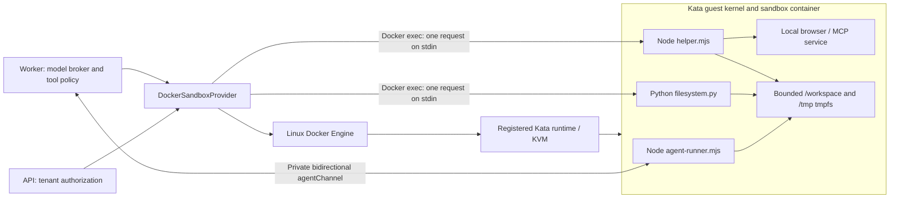
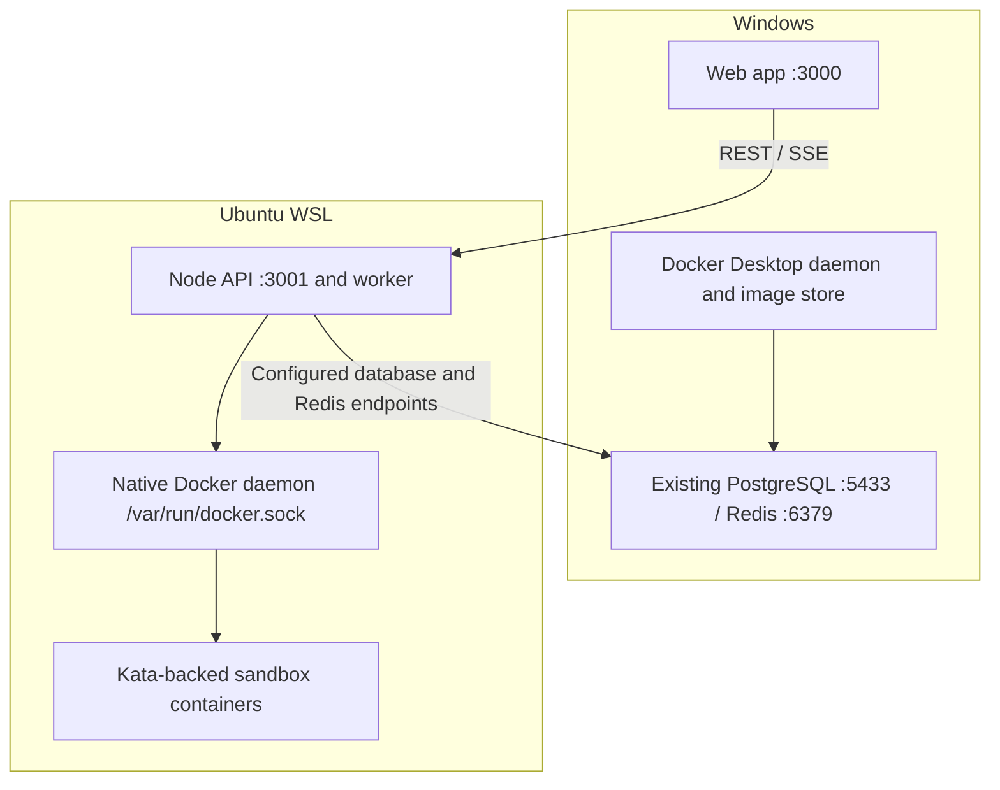

# Architecture

Zlayer uses Bun for package management and a Turborepo workspace with Fastify, Next.js, Drizzle/PostgreSQL,
BullMQ/Redis, Docker and private Cloudflare R2 storage. Shared imports use `@repo/*`.

API and worker scripts run on Node through `tsx`. In the configured Windows
development setup, they run inside Ubuntu WSL against its native Docker Engine;
the web application runs on Windows. Docker selects the registered Kata runtime
for sandbox containers. Kata gives those workloads a guest Linux kernel while
Docker remains responsible for images, lifecycle and exec operations.

## Boundaries

| Location                               | Responsibility                                               |
| -------------------------------------- | ------------------------------------------------------------ |
| `apps/http/src/index.ts`               | Connections, dependency wiring, listening and shutdown       |
| `apps/http/src/app.ts`                 | HTTP plugins, authentication boundaries and error handling   |
| `apps/http/src/lib/openapi.ts`         | Route contracts and generated OpenAPI document               |
| `apps/http/src/lib/request-tracing.ts` | Request and handler trace lifecycle                          |
| `apps/http/src/modules`                | Organization-scoped feature routes and services              |
| `apps/worker`                          | Outbox delivery, execution claims, leases and reconciliation |
| `apps/web/src/components`              | Pixel dashboard, settings and workspace controls             |
| `packages/agent-runtime`               | Provider adapters, model router, tool registry and MCP       |
| `packages/agent-runner`                | Credential-free agent loop executed inside the sandbox       |
| `packages/sandbox`                     | Docker lifecycle and bounded execution bridge                |
| `packages/sandbox/image`               | Non-root shell/filesystem/browser/MCP helper source          |
| `packages/storage`                     | Private R2 objects, checksums, metadata and signed downloads |
| `packages/db`                          | Drizzle schema, permissions, encryption, events and metering |
| `packages/sdk`                         | Compiled TypeScript client and resumable event streaming     |
| `packages/env`                         | Server environment loading and validation                    |
| `packages/observability`               | Structured logs and optional OTLP traces/metrics             |

## Execution flow

The API authorizes the organization and captures the caller's tool permissions.
Run creation, quota reservations, initial event, optional session message and an
outbox record share a PostgreSQL transaction. The outbox publisher submits a
stable BullMQ job ID and retries delivery. A worker claims only queued records,
sets a lease, and fences writes with lease owner and attempt number.

The worker starts the agent runner inside the assigned sandbox through a private
Docker exec channel. It holds provider credentials and brokers model/tool access;
the agent loop, message assembly and tool selection run in the sandbox. Per-sandbox
claims serialize agent runs across workers. Checkpoints and usage counters are
validated and persisted by the supervisor, never accepted as billing authority
from the runner. See [sandbox agents](docs/sandbox-agents.md).

The runtime preserves provider tool-call IDs and native Anthropic content. Tools
validate JSON schemas and arguments, then apply organization policy, captured
permissions, exact command restrictions and one-use approvals before execution.
Checkpoints contain model messages and consumed budgets. Four model providers are
supported: Anthropic, OpenAI, DeepSeek and OpenRouter. Aliases, explicit fallback
order and OpenRouter routing are organization settings. Streaming text and model
usage are persisted as execution events.

Run completion, terminal event and assistant session message commit together.
Failure, expired-lease recovery and cancellation also commit status and event
together. Lease expiry marks uncertain work interrupted; it does not replay shell
or external side effects. Explicit resume acknowledges uncertainty and continues
from a checkpoint. Shell executions use a separate queue and lease.

## Sandbox image and execution protocols

The sandbox image and the host runtime are separate layers. The
[Dockerfile](packages/sandbox/image/Dockerfile) defines sandbox userspace; the
Docker host's `kata` registration determines its kernel isolation. Zlayer uses
Docker's API through `DockerSandboxProvider`, not a separate containerd endpoint.

The agent's workspace operations are requested through worker-authorized tools;
the runner does not receive provider keys or host control-plane credentials.

### Image construction

| Build stage or instruction                | Result                                                                                               |
| ----------------------------------------- | ---------------------------------------------------------------------------------------------------- |
| `oven/bun:1.3.5` builder                  | Installs locked workspace dependencies with scripts disabled and bundles `@repo/agent-runner`        |
| `node:22-bookworm-slim` runtime           | Provides Node and Linux userspace; installs Python, `tini`, pinned browser/MCP packages and Chromium |
| `COPY` helpers and builder output         | Installs `helper.mjs`, `filesystem.py` and `agent-runner.mjs` under `/opt/zlayer`                    |
| `USER 1000:1000` and `WORKDIR /workspace` | Executes workloads without root privileges in their workspace                                        |
| `tini -- sleep infinity`                  | Keeps the sandbox available, forwards signals and reaps exited child processes                       |

The build context excludes `.env`, dependency directories and generated build
output. Runtime environment defaults locate Chromium under `/opt/zlayer/browsers`,
set `/workspace` as home and `/tmp` as temporary storage. The image's labels
describe agent availability and the JSON-line filesystem protocol. Kata itself is
installed on the host, not bundled into this image.

Docker creation adds a read-only root filesystem, dropped capabilities,
`no-new-privileges`, bounded tmpfs mounts, and CPU/memory/PID limits. The API and
creation form require at least 512 MB for Kata. Workspaces are ephemeral; durable
exports go to private artifact storage.

### Agent channel versus helper requests

| Executable launched with Docker exec  | Communication and responsibility                                                                                                           |
| ------------------------------------- | ------------------------------------------------------------------------------------------------------------------------------------------ |
| `node /opt/zlayer/agent-runner.mjs`   | Persistent bidirectional `agentChannel` for model requests, authorized tool calls, checkpoints and the final result                        |
| `python3 /opt/zlayer/filesystem.py`   | One bounded JSON-line request on stdin; one `{ result }` or `{ error }` response on stdout; then exit                                      |
| `node /opt/zlayer/helper.mjs --stdin` | One JSON-line shell or service request; returns a JSON response; service requests can start or contact the sandbox's local service process |

`invoke()` defaults to the Node helper command. `file()` explicitly passes the
Python command to the same Docker exec transport. There is no operation-based
compatibility router or inline Python adapter. Requests stay on stdin instead of
being interpolated into command arguments or host shell commands.

The Python helper enforces workspace boundaries, refuses symlink traversal and
limits file transfers. File operations avoid Node/MCP startup entirely. The Node
service imports the MCP stdio transport only for an MCP session, and imports
Playwright only when creating a browser. The shared agent channel and one-shot
helper requests have distinct framing and lifetimes.

Protocol changes require rebuilding the image and creating fresh sandboxes. A
new tag does not update existing containers, and the provider assumes the rebuilt
image is used rather than adapting requests for older helpers.

## Windows and Ubuntu Docker topology

This workstation has two independent Docker daemons and image stores:

`bun run dev:backend:wsl` starts API and worker inside Ubuntu using Linux Node and
the installed Linux esbuild executable for `tsx`. Both read the same root `.env`
and use the native Unix Docker socket. The web app can run separately on Windows.
The launcher does not start the optional remote MCP server or initialize databases.

`bun run sandbox:build:wsl` builds into Ubuntu's native Docker image store.
`bun run sandbox:build` uses the current Docker CLI context; from Windows that is
normally Docker Desktop. Images can be moved using `docker save` and `docker load`,
but the stores do not synchronize automatically. A Docker CLI context does not
change the explicit socket used by `dockerode` in Zlayer.

All application configuration remains in the ignored root `.env`, with only the
root `.env.example` template committed. Injected variables take precedence. The
browser reads only explicitly public `NEXT_PUBLIC_*` values. See
[Kata setup](docs/kata-runtime.md) for commands and host prerequisites. Production
uses a Linux Docker host with KVM and Kata; it does not require WSL.

## State and events

Sessions retain conversations and associated runs. Run events have monotonically
increasing per-run sequence numbers protected by a row lock. SSE accepts
`Last-Event-ID`; the SDK reconnects and suppresses duplicate sequences. Replay
reads persisted events without executing side effects. Checkpoints can be exported
to private R2 artifacts. Sandbox creation/destruction and artifact creation/deletion
have durable organization activity records committed with their final DB state.

Mutation audit records are written before a successful HTTP response and contain
actor, route and resource ID, never response bodies. They use a separate transaction
from the feature mutation; a process failure between the two can leave an audit
gap. R2 and Docker changes also cannot share a PostgreSQL transaction. Reconciliation
cleans abandoned resources, and callers must account for uncertain outcomes.

## Configuration and operations

See [environment setup](ENVIRONMENT.md), [HTTP contracts](apps/http/README.md),
[SDK usage](packages/sdk/README.md) and [security boundaries](SECURITY.md).
No install, startup, build or verification command applies schemas or generates
migrations. Contract tests cover HTTP authentication, MCP, agent supervision and
the sandbox transport. Opt-in `sandbox:smoke-image` verifies files, path
restrictions, shell, MCP stdio and Chromium on a temporary sandbox;
`sandbox:smoke-agent` verifies the private broker, approvals/resume, cancellation
and cleanup. These checks do not use the application database or live model keys.
Live provider, database/queue recovery and adversarial integration acceptance
remain separate from these checks. Application deployment and monitoring
infrastructure are deferred.
