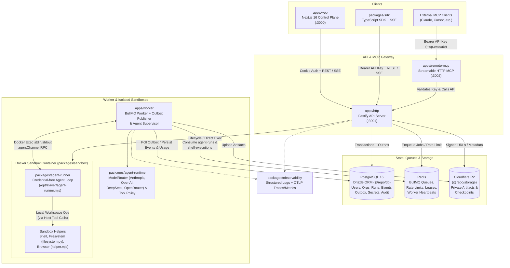
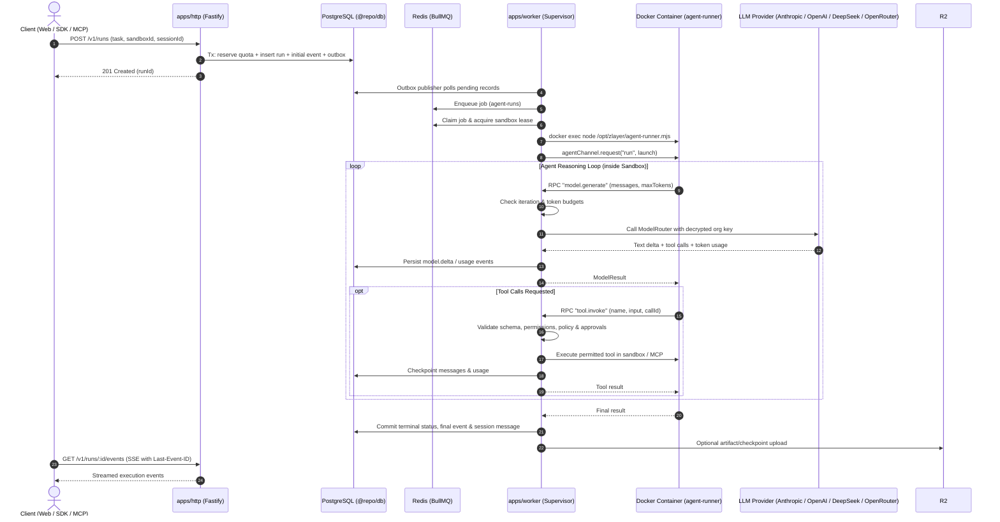

# Zlayer

An agentic sandbox control plane for running autonomous AI agents inside isolated Docker containers with host-brokered LLM calls, policy-enforced tool execution, resumable event streaming, and an organization-scoped workspace UI.

---

## Key Capabilities

- **Isolated Sandbox Execution** — Runs the credential-free agent loop (`@repo/agent-runner`) inside non-root Docker containers (`1000:1000` in `/workspace`) with bounded shell, filesystem, and browser helpers.
- **Host-Brokered Security Model** — Model API keys, organization secrets, and tool authorization never enter the sandbox. The runner requests model generations, tool calls, and checkpoints over a private `stdin`/`stdout` RPC channel (`agentChannel`) supervised by the host worker.
- **Multi-Provider Model Gateway** — Supports **Anthropic**, **OpenAI**, **DeepSeek**, and **OpenRouter** with per-organization encrypted credentials, model aliases, explicit fallback order, and token/iteration budget enforcement.
- **Governance, Policies & Approvals** — Scoped API keys, RBAC (`owner`, `admin`, `developer`, `viewer`), execution policies, one-use approval gates, usage metering, and durable audit logs.
- **Resumable Sessions & Streaming** — Persistent conversation sessions, monotonically sequenced run events, SSE streaming (`Last-Event-ID`), and checkpointing.
- **MCP Integration & Remote MCP Server** — Connects agents to external MCP servers and exposes Zlayer itself over Streamable HTTP (`apps/remote-mcp` on port `3002`).
- **Private Artifact Storage** — Stores sandbox artifacts and exported checkpoints in private Cloudflare R2 buckets with checksums and signed download URLs.

---

## System Design

### High-Level Architecture



### Agent Run Execution Flow (Host-Brokered Sandbox)



---

## Repository Structure

### Applications (`apps/`)

| App                                            | Port   | Description                                                                                                              |
| ---------------------------------------------- | ------ | ------------------------------------------------------------------------------------------------------------------------ |
| [`apps/web`](apps/web/README.md)               | `3000` | Next.js 16 + React 19 control plane dashboard (TanStack Query, Zustand, Tailwind CSS v4, `@repo/ui`).                    |
| [`apps/http`](apps/http/README.md)             | `3001` | Fastify HTTP API with cookie & API-key auth, OpenAPI generation, rate limiting, and SSE event streaming.                 |
| [`apps/worker`](apps/worker/README.md)         | —      | BullMQ worker (`agent-runs` & `shell-executions`), transactional outbox publisher, lease recovery, and agent supervisor. |
| [`apps/remote-mcp`](apps/remote-mcp/README.md) | `3002` | Stateless Streamable HTTP MCP server exposing Zlayer platform tools to external MCP clients.                             |

### Packages (`packages/`)

| Package                   | Description                                                                                                               |
| ------------------------- | ------------------------------------------------------------------------------------------------------------------------- |
| `@repo/agent-runner`      | Credential-free agent loop running inside the sandbox container over `agentChannel`.                                      |
| `@repo/agent-runtime`     | `ModelRouter`, provider adapters (Anthropic, OpenAI, DeepSeek, OpenRouter), tool registry, and MCP client bridging.       |
| `@repo/sandbox`           | `DockerSandboxProvider` for container lifecycle, image verification, bounded exec, and `packages/sandbox/image` helpers.  |
| `@repo/db`                | Drizzle ORM schema, PostgreSQL connection pool, AES encryption for secrets/keys, approvals, events, and usage settlement. |
| `@repo/storage`           | Private Cloudflare R2 object uploads, checksums, metadata, and signed download URLs.                                      |
| `@repo/sdk`               | Typed TypeScript client (`AgentPlatformClient`) with automatic retries and resumable `Last-Event-ID` SSE streaming.       |
| `@repo/env`               | Centralized server environment loading and Zod validation from the root `.env`.                                           |
| `@repo/shared`            | Shared job contracts (`RunJob`) and bidirectional `agentChannel` framing over Node streams.                               |
| `@repo/observability`     | Structured logging and optional OpenTelemetry (OTLP) traces and metrics.                                                  |
| `@repo/ui`                | Shared UI component library (shadcn/ui + Radix primitives).                                                               |
| `@repo/local-mcp`         | Local stdio MCP server package.                                                                                           |
| `@repo/mcp-client`        | Shared MCP client utilities.                                                                                              |
| `@repo/mcp-server`        | Shared MCP server tool definitions and handlers.                                                                          |
| `@repo/typescript-config` | Shared `tsconfig` presets across apps and packages.                                                                       |

---

## Getting Started

### Prerequisites

- [Bun](https://bun.sh/) (`1.3.5+`)
- [Node.js](https://nodejs.org/) (`>= 18`, used via `tsx` by `apps/http` and `apps/worker` for Docker named-pipe compatibility)
- [Docker](https://www.docker.com/) (Docker Desktop / Engine)

### 1. Install dependencies & start infrastructure

```sh
bun install
docker compose up -d
```

`docker-compose.yml` starts:

- **PostgreSQL 16** on `localhost:5433`
- **Redis** on `localhost:6379`

### 2. Configure environment

Create a root `.env` from `.env.example`:

```sh
cp .env.example .env
```

Key variables in `.env`:

- `DATABASE_URL` / `REDIS_URL` — PostgreSQL and Redis connection strings.
- `PORT` / `WEB_URL` / `NEXT_PUBLIC_API_BASE` — API (`3001`) and Web (`3000`) URLs.
- `GOOGLE_CLIENT_ID` & `NEXT_PUBLIC_GOOGLE_CLIENT_ID` — Optional Google OAuth sign-in.
- `ENCRYPTION_KEY` — Required for encrypting organization provider keys and secrets.
- `SANDBOX_IMAGE` — Docker sandbox image (default `zlayer-sandbox:local`).
- `R2_ACCOUNT_ID`, `R2_BUCKET`, `R2_ACCESS_KEY_ID`, `R2_SECRET_ACCESS_KEY` — Private Cloudflare R2 storage for artifacts.

See [ENVIRONMENT.md](ENVIRONMENT.md) for full configuration and sandbox image build instructions.

### 3. Push database schema

No install, build, or startup command automatically alters your database. Review `packages/db/schema/index.ts` and push the schema explicitly:

```sh
bun run db:push
```

### 4. Build the sandbox image

Build the helper/runner image before creating sandboxes (see [ENVIRONMENT.md](ENVIRONMENT.md)):

```sh
bun run sandbox:build
```

### 5. Run the development stack

```sh
bun run dev
```

- **Web Control Plane:** `http://localhost:3000`
- **HTTP API:** `http://localhost:3001`
- **Remote MCP Server** (optional): `bun run --cwd apps/remote-mcp start` (`http://localhost:3002/mcp`)

---

## Scripts & Verification

```sh
bun run check-dependencies   # Enforce single resolved dependency versions across workspaces
bun run check-types          # TypeScript type-checking via Turborepo
bun run lint                 # Biome lint across apps, packages, and scripts
bun run format               # Prettier formatting across *.ts, *.tsx, *.md
bun run test                 # Run HTTP contract tests (in-memory auth repository)
bun run build                # Build all apps and packages
```

---

## Documentation

- [ARCHITECTURE.md](ARCHITECTURE.md) — Detailed module boundaries, transactional outbox, leases, and event replay
- [ENVIRONMENT.md](ENVIRONMENT.md) — Environment variables, Docker sandbox image, and R2 setup
- [SECURITY.md](SECURITY.md) — Security boundaries, trust model, and known limitations
- [docs/sandbox-agents.md](docs/sandbox-agents.md) — In-sandbox agent runner & host supervisor protocol
- [docs/mcp-architecture.md](docs/mcp-architecture.md) — Remote MCP server architecture
- [apps/http/README.md](apps/http/README.md) — HTTP API endpoints and OpenAPI contract
- [packages/sdk/README.md](packages/sdk/README.md) — TypeScript SDK usage

---

## License

This project is licensed under the [MIT License](LICENSE).
