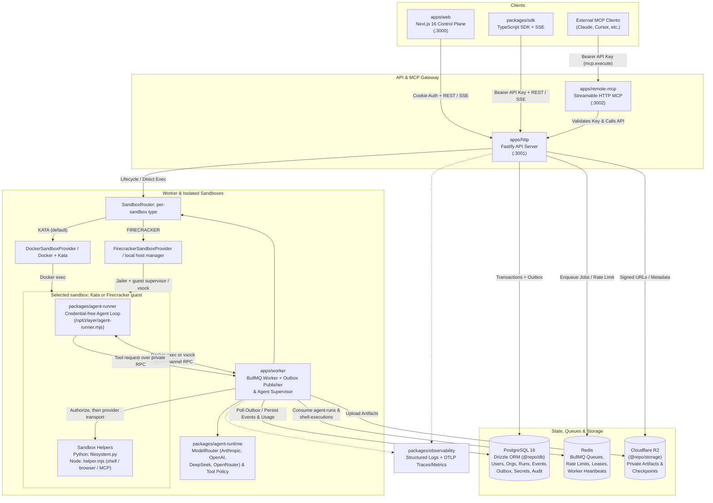
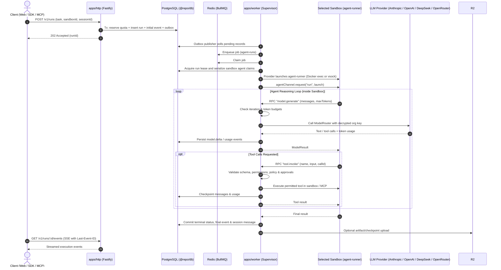

# Zlayer

An agentic sandbox control plane for running autonomous AI agents inside selectable Kata or Firecracker sandboxes with host-brokered LLM calls, policy-enforced tool execution, resumable event streaming, and an organization-scoped workspace UI.

---

## Key Capabilities

- **Isolated Sandbox Execution** — Docker selects the host-registered `kata` runtime to run each sandbox with a guest Linux kernel. The credential-free agent loop (`@repo/agent-runner`) and helpers run as `1000:1000` in `/workspace`; the creation API and UI require at least 512 MB. Firecracker is available as a second sandbox type through a dedicated Linux host manager.
- **Host-Brokered Security Model** — Model provider keys remain on the worker. The runner requests model generations, tool calls, and checkpoints over a private `stdin`/`stdout` RPC channel (`agentChannel`), and the worker checks authorization. Secrets explicitly passed to an approved tool remain accessible to that tool inside the sandbox.
- **Multi-Provider Model Gateway** — Supports **Anthropic**, **OpenAI**, **DeepSeek**, and **OpenRouter** with per-organization encrypted credentials, model aliases, explicit fallback order, and token/iteration budget enforcement.
- **Governance, Policies & Approvals** — Scoped API keys, RBAC (`owner`, `admin`, `developer`, `viewer`), execution policies, one-use approval gates, usage metering, and durable audit logs.
- **Resumable Sessions & Streaming** — Persistent conversation sessions, monotonically sequenced run events, SSE streaming (`Last-Event-ID`), and checkpointing.
- **MCP Integration & Remote MCP Server** — Connects agents to external MCP servers and exposes Zlayer itself over Streamable HTTP (`apps/remote-mcp` on port `3002`).
- **Private Artifact Storage** — Stores sandbox artifacts and exported checkpoints in private Cloudflare R2 buckets with checksums and signed download URLs.

---

## System Design

### High-Level Architecture



### Agent Run Execution Flow (Host-Brokered Sandbox)



---

### Sandbox providers

Choose **Kata (Docker)** or **Firecracker** when creating a sandbox. The API accepts
`type: "KATA" | "FIRECRACKER"`, defaulting to Kata. Both types can coexist;
existing sandboxes retain their provider. Firecracker requires 1 or 2 whole vCPUs.

The Firecracker backend uses a local Linux host manager, jailer, a read-only
ext4 rootfs and a guest supervisor over vsock. Model credentials stay on the
worker. Approved HTTP/HTTPS egress uses a per-VM allowlist proxy over vsock;
there is no guest NIC or host firewall modification. Its 256 MB workspace
survives stop/start and is deleted on sandbox destruction.

See [Firecracker setup, lifecycle and verification](docs/firecracker-runtime.md).
The existing Docker + Kata setup remains available. Apply the sandbox type schema
change separately; builds, startup and smoke tests do not change the database.

### Sandbox Image and Helper Processes

The [Dockerfile](packages/sandbox/image/Dockerfile) builds the agent bundle with
Bun, then copies it into a Node 22 Debian image containing Python, Chromium and
the MCP client SDK. The build excludes `.env` files. `tini` supervises processes,
and `sleep infinity` keeps the sandbox available for Docker exec requests.
Kata is installed on the Docker host; it is not installed inside this image.

| Process inside the sandbox            | Purpose                                                                  |
| ------------------------------------- | ------------------------------------------------------------------------ |
| `node /opt/zlayer/agent-runner.mjs`   | Agent loop with a persistent private worker supervision channel          |
| `python3 /opt/zlayer/filesystem.py`   | One bounded JSON-line file request on stdin, one JSON response on stdout |
| `node /opt/zlayer/helper.mjs --stdin` | Shell execution and requests to the sandbox's local service process      |

File operations launch Python directly. MCP and Playwright load only when their
features are used. The provider passes executable arguments directly to Docker
exec; request data travels separately through stdin. There is no old-image
adapter: rebuild the image and create fresh sandboxes when its helper protocol
changes. See [architecture](ARCHITECTURE.md#sandbox-image-and-execution-protocols).

---

## Repository Structure

### Applications (`apps/`)

| App                                            | Port   | Description                                                                                                              |
| ---------------------------------------------- | ------ | ------------------------------------------------------------------------------------------------------------------------ |
| [`apps/web`](apps/web/README.md)               | `3000` | Next.js 16 + React 19 control plane dashboard (TanStack Query, Zustand, Tailwind CSS v4, `@repo/ui`).                    |
| [`apps/http`](apps/http/README.md)             | `3001` | Fastify HTTP API with cookie & API-key auth, OpenAPI generation, rate limiting, and SSE event streaming.                 |
| [`apps/worker`](apps/worker/README.md)         | —      | BullMQ worker (`agent-runs` & `shell-executions`), transactional outbox publisher, lease recovery, and agent supervisor. |
| [`apps/remote-mcp`](apps/remote-mcp/README.md) | `3002` | Stateless Streamable HTTP MCP server exposing Zlayer platform tools to external MCP clients.                             |

### Packages (`packages/`)

| Package                   | Description                                                                                                               |
| ------------------------- | ------------------------------------------------------------------------------------------------------------------------- |
| `@repo/agent-runner`      | Credential-free agent loop running inside the sandbox container over `agentChannel`.                                      |
| `@repo/agent-runtime`     | `ModelRouter`, provider adapters (Anthropic, OpenAI, DeepSeek, OpenRouter), tool registry, and MCP client bridging.       |
| `@repo/sandbox`           | Per-sandbox routing, Docker/Kata provider, Firecracker host manager and guest transports.                                 |
| `@repo/db`                | Drizzle ORM schema, PostgreSQL connection pool, AES encryption for secrets/keys, approvals, events, and usage settlement. |
| `@repo/storage`           | Private Cloudflare R2 object uploads, checksums, metadata, and signed download URLs.                                      |
| `@repo/sdk`               | Typed TypeScript client (`AgentPlatformClient`) with automatic retries and resumable `Last-Event-ID` SSE streaming.       |
| `@repo/env`               | Centralized server environment loading and Zod validation from the root `.env`.                                           |
| `@repo/shared`            | Shared job contracts (`RunJob`) and bidirectional `agentChannel` framing over Node streams.                               |
| `@repo/observability`     | Structured logging and optional OpenTelemetry (OTLP) traces and metrics.                                                  |
| `@repo/ui`                | Shared UI component library (shadcn/ui + Radix primitives).                                                               |
| `@repo/local-mcp`         | Local stdio MCP server package.                                                                                           |
| `@repo/mcp-client`        | Shared MCP client utilities.                                                                                              |
| `@repo/mcp-server`        | Shared MCP server tool definitions and handlers.                                                                          |
| `@repo/typescript-config` | Shared `tsconfig` presets across apps and packages.                                                                       |

---

## Getting Started

### Prerequisites

- [Bun](https://bun.sh/) (`1.3.5`, matching the workspace package manager)
- [Node.js](https://nodejs.org/) (`>= 20`; the configured Ubuntu setup uses Node 22 and `tsx`)
- Linux Docker Engine 28+, KVM and a registered Kata runtime on the sandbox host

For Windows development, the backend uses **Ubuntu WSL's native Docker Engine**.
Docker Desktop is a separate engine with a separate image store. Installing Kata
inside Ubuntu does not register it with Docker Desktop. Follow the
[Kata setup guide](docs/kata-runtime.md) before creating sandboxes.

### 1. Install dependencies & start infrastructure

```sh
bun install
docker compose up -d
```

`docker-compose.yml` starts:

- **PostgreSQL 16** on `localhost:5433`
- **Redis** on `localhost:6379`

### 2. Configure environment

For a fresh checkout, create the single root `.env` from `.env.example`. Preserve
an existing `.env`, especially its encryption key. No per-app env files are needed.

```sh
cp .env.example .env
```

Key variables in `.env`:

- `DATABASE_URL` / `REDIS_URL` — PostgreSQL and Redis connection strings.
- `PORT` / `WEB_URL` / `NEXT_PUBLIC_API_BASE` — API (`3001`) and Web (`3000`) URLs.
- `GOOGLE_CLIENT_ID` & `NEXT_PUBLIC_GOOGLE_CLIENT_ID` — Optional Google OAuth sign-in.
- `ENCRYPTION_KEY` — Required for encrypting organization provider keys and secrets.
- `SANDBOX_IMAGE` — Docker sandbox image (default `zlayer-sandbox:local`).
- `SANDBOX_RUNTIME=kata` / `DOCKER_SOCKET=/run/zlayer-docker.sock` — Native Linux Docker runtime and socket for the Ubuntu backend.
- `FIRECRACKER_SOCKET=/run/zlayer-firecracker/manager.sock` and `FIRECRACKER_SOCKET_GID` configure access to the optional Linux host manager.
- `R2_ACCOUNT_ID`, `R2_BUCKET`, `R2_ACCESS_KEY_ID`, `R2_SECRET_ACCESS_KEY` — Private Cloudflare R2 storage for artifacts.

See [ENVIRONMENT.md](ENVIRONMENT.md) for full configuration and sandbox image build instructions.

### 3. Initialize a fresh database only when needed

No install, build, or startup command automatically alters your database. For a
new database, review the schema and apply it explicitly. Skip this step for an
already configured database unless you intend to change its schema:

```sh
bun run db:push
```

### 4. Build the sandbox image

The configured workstation already has the Kata image and Firecracker rootfs.
Starting the app or fixing API/UI response schemas does not require rebuilding
those artifacts. Rebuild after changing guest code or dependencies, then create
fresh sandboxes. Firecracker rootfs/host builds have separate commands in its
[setup guide](docs/firecracker-runtime.md).

For this Windows/Ubuntu setup, build directly into the Docker engine used by the backend:

```powershell
bun run sandbox:build:wsl
```

On a Linux host where the CLI and backend use the same Docker engine:

```sh
bun run sandbox:build
```

### 5. Run the development stack

On this configured workstation, ensure Docker Desktop is running for PostgreSQL
and Redis, and start the Ubuntu host services:

```powershell
wsl -d Ubuntu --exec sudo systemctl start docker zlayer-firecracker
```

The Firecracker service is required only for Firecracker sandboxes. First-time
installation is covered in the [Firecracker guide](docs/firecracker-runtime.md).

From two Windows terminals in the repository root:

```powershell
# Terminal 1: API and worker inside Ubuntu WSL
bun run dev:backend:wsl

# Terminal 2: web app on Windows
bun run --cwd apps/web dev
```

Do not also run `bun run dev` in Windows: that starts another backend targeting
Docker Desktop's named pipe. The WSL launcher uses the existing source checkout
and root `.env`; it does not initialize databases. On a fully Linux development
host with its tools and Docker configured, use `bun run dev` normally.

The launcher's ?Starting API and worker? message confirms process launch, not
readiness. Wait for the API listening log; `http://localhost:3001/health/ready`
checks database and Redis readiness. Cold `tsx --watch` startup can be slow when
the source and dependencies live under `/mnt/c`. Keeping a Linux checkout and
Linux dependencies in Ubuntu's filesystem avoids that cross-filesystem loading.
Do not reuse Linux-installed dependencies for the Windows web process.

- **Web Control Plane:** `http://localhost:3000`
- **HTTP API:** `http://localhost:3001`
- **Remote MCP Server** (optional): `bun run --cwd apps/remote-mcp start` (`http://localhost:3002/mcp`)

---

## Scripts & Verification

```sh
bun run check-dependencies   # Enforce single resolved dependency versions across workspaces
bun run check-types          # TypeScript type-checking via Turborepo
bun run lint                 # Biome lint across apps, packages, and scripts
bun run format               # Prettier formatting across *.ts, *.tsx, *.md
bun run test                 # HTTP, MCP, agent supervisor and sandbox contract tests
bun run build                # Build all apps and packages
```

Opt-in integration checks create and remove temporary sandboxes without touching
application databases. Run them on the configured Linux sandbox host:

```sh
bun run sandbox:smoke-image  # Files, path restrictions, shell, MCP stdio and Chromium
bun run sandbox:smoke-agent  # Agent broker, approvals/resume, cancellation and cleanup
bun run sandbox:smoke-firecracker  # Image and agent checks against Firecracker
node --import tsx apps/worker/src/smoke-firecracker-lifecycle.ts  # Persistence, egress and resource limits
```

The [Kata guide](docs/kata-runtime.md) includes the PowerShell-to-WSL equivalents.

---

## Documentation

- [ARCHITECTURE.md](ARCHITECTURE.md) — Detailed module boundaries, transactional outbox, leases, and event replay
- [ENVIRONMENT.md](ENVIRONMENT.md) — Environment variables, Docker sandbox image, and R2 setup
- [SECURITY.md](SECURITY.md) — Security boundaries, trust model, and known limitations
- [docs/sandbox-agents.md](docs/sandbox-agents.md) — In-sandbox agent runner & host supervisor protocol
- [docs/kata-runtime.md](docs/kata-runtime.md) — Kata host setup, separate Docker engines, image builds and live checks
- [docs/firecracker-runtime.md](docs/firecracker-runtime.md) ? Firecracker builds, host service, networking, lifecycle and recovery
- [docs/mcp-architecture.md](docs/mcp-architecture.md) — Remote MCP server architecture
- [apps/http/README.md](apps/http/README.md) — HTTP API endpoints and OpenAPI contract
- [packages/sdk/README.md](packages/sdk/README.md) — TypeScript SDK usage

---

## License

This project is licensed under the [MIT License](LICENSE).
