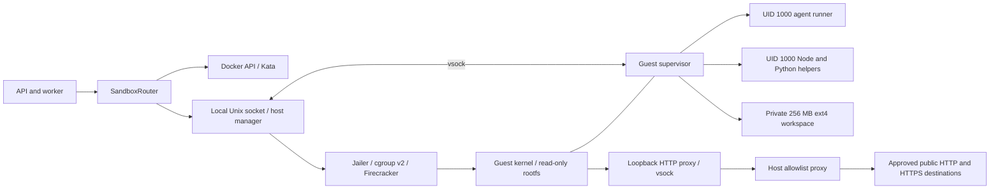

# Firecracker sandbox provider

ZLayer supports two sandbox types in the same deployment:

| API `type`       | Runtime                                 | Application execution      |
| ---------------- | --------------------------------------- | -------------------------- |
| `KATA` (default) | Docker with the registered Kata runtime | Docker exec                |
| `FIRECRACKER`    | Firecracker launched by jailer          | Host-only vsock supervisor |

The type is chosen when a sandbox is created and stored in the sandbox table.
Existing Docker resource IDs remain valid. Firecracker resource IDs use
`firecracker:<uuid>`, so API and worker processes route operations consistently
without a global provider switch or an in-memory lookup. There is no fallback
between providers. Apply your schema change separately before using the new
field; installation and verification never run database commands.

## Execution and networking



No TAP device, guest network interface, host NAT, or host firewall change is
needed. The guest has loopback only. It reaches the per-VM host proxy through
vsock, with exact hostname checks, public IPv4 resolution, and ports 80/443 only.
Unapproved hosts and private addresses are rejected. When the allowlist is empty,
there is no host egress listener. Programs must support an HTTP proxy to use
network access; arbitrary UDP, DNS, TCP, and inbound previews are not provided.

The worker retains model credentials and brokers model/tool/checkpoint requests
over the existing `agentChannel` protocol. The root guest supervisor accepts a
fixed list of process types from host CID 2. All application processes run as
UID/GID 1000 with no capabilities and `no-new-privileges`.

VMs have dedicated host UIDs, jailer mount/PID isolation, default Firecracker
seccomp filters, CPU quotas, guest memory plus 192 MB of VMM headroom, no host
swap, and a 256-task host cgroup limit. Guest workload processes have a 128-task
user limit. Workspace block I/O is rate limited. Memory statistics describe the
host VM cgroup, including guest memory, virtualization overhead and the egress proxy.

## Linux host requirements

- Linux with usable KVM, cgroup v2 and `cgroup.kill`; WSL2 Ubuntu is the development host.
- Matching Firecracker and jailer binaries. The current development installation uses v1.18.0.
- Node.js 22, Docker for building userspace, and `mkfs.ext4` from `e2fsprogs`.
- An uncompressed guest kernel with ext4, devtmpfs, virtio block/MMIO and virtio-vsock built in. The tested development kernel is the existing Kata `vmlinux-6.18.56-208`.
- Reserve the configured host UID range exclusively for this service. With defaults, reserve 40000–40031; do not allocate normal host users to it.

The executable, kernel, rootfs, helper and their parent directories must be
root-owned and not group/world writable. The manager rejects insecure paths.
Install verified release archives with `tar --no-same-owner` or correct their
ownership after extraction. Keep the host, guest kernel and Firecracker patched.

See upstream [production host guidance](https://github.com/firecracker-microvm/firecracker/blob/v1.18.0/docs/prod-host-setup.md)
and [vsock protocol](https://github.com/firecracker-microvm/firecracker/blob/v1.18.0/docs/vsock.md).

## Build artifacts

From the repository root:

```bash
bun run firecracker:build-host
```

This produces `packages/sandbox/dist/host.mjs` and `helper.mjs`. The host helper
uses only its proxy branch. MCP and browser dependencies stay inside the guest.

Build the normal sandbox image first, then produce the Firecracker rootfs:

```bash
bun run sandbox:build
sudo sh scripts/build-firecracker-rootfs.sh /var/tmp/zlayer-rootfs-v1.ext4
```

On Windows, build against native Ubuntu Docker:

```powershell
bun run sandbox:build:wsl
wsl -d Ubuntu -u root --exec sh scripts/build-firecracker-rootfs.sh /var/tmp/zlayer-rootfs-v1.ext4
```

The script refuses to overwrite an existing output, exports the build container,
and populates a 4 GB ext4 image without mounting it on the host. A trap removes
its build container and temporary extraction directory. The image contains the
existing Node runtime, Chromium, official MCP v2 client, Python filesystem helper
and agent runner, plus Firecracker init and the vsock supervisor.

Install artifacts inside Ubuntu as root:

```bash
sudo install -d -m 0755 /opt/zlayer-firecracker
sudo install -m 0644 packages/sandbox/dist/host.mjs /opt/zlayer-firecracker/host.mjs
sudo install -m 0644 packages/sandbox/dist/helper.mjs /opt/zlayer-firecracker/helper.mjs
sudo install -m 0444 /path/to/trusted/vmlinux /opt/zlayer-firecracker/vmlinux
sudo install -m 0444 /var/tmp/zlayer-rootfs-v1.ext4 /opt/zlayer-firecracker/rootfs.ext4
```

Publish a replacement rootfs/kernel atomically or under a new filename. Existing
VMs retain their boot artifact links across stop/start; new VMs use the newly
configured artifacts. Destroy and recreate a sandbox to upgrade its userspace.
Stop the manager before upgrading the Firecracker executable, and remove old
jail directories through normal sandbox destruction before changing its version.

## Configure and start the host service

All application settings stay in the repository-root `.env`. The available
`FIRECRACKER_*` settings are documented in the root `.env.example`.

Set `FIRECRACKER_SOCKET_GID` to a Linux group shared by the API and worker, for
example the numeric output of `getent group docker`. The default is root-only.
Access to this Unix socket grants control over all VMs managed by the service;
never expose it to sandbox users or through a public TCP listener.

Copy the supplied unit and set its `EnvironmentFile` to the one root `.env`:

```bash
sudo cp packages/sandbox/image/firecracker/zlayer-firecracker.service /etc/systemd/system/
sudoedit /etc/systemd/system/zlayer-firecracker.service
sudo systemctl daemon-reload
sudo systemctl enable --now zlayer-firecracker
sudo journalctl -u zlayer-firecracker -n 30 --no-pager
```

The service is a privileged host component. Production bundles, its unit and its
configuration should be managed by a trusted administrator. The rootfs builder
is a separate administrative build step, never part of application startup.

The existing `dev:backend:wsl` launcher still starts the API and worker and
checks Kata availability. The Firecracker manager runs separately under systemd.

## Lifecycle and recovery

Pause/resume uses Firecracker's VM API. Graceful stop confirms a bounded guest filesystem sync, then kills the VM cgroup and closes its
channels and proxy, and retains workspace storage. The workspace uses writeback caching so guest flush requests reach the host backing file; file-operation mutations sync their data and parent directories. Start boots the same rootfs
and workspace again. Restart performs stop followed by start. Destroy removes
the VM, workspace, metadata, jail and cgroup; repeated destruction is safe.

Cancellation or an execution timeout/output limit skips graceful flushing and stops the entire VM so detached
workload descendants cannot continue running. A normal helper connection closing
terminates its process group. Browser and MCP service processes live until closed
explicitly or until the VM stops.

Metadata is persisted under `FIRECRACKER_STATE_DIR/INSTANCE_ID`. On manager restart,
surviving VM cgroups are terminated before accepting clients. Recorded sandboxes
remain stopped and can be started again; they are never silently recreated with
an empty workspace. Worker reconciliation removes unreferenced VMs after a
two-minute grace period. API and worker must use the same host socket/instance.

Workspace files survive stop/start but are temporary sandbox data, removed by
destroy/expiration. Artifacts remain the durable storage mechanism. There is no
snapshot restore, warm pool, cross-host scheduling or live migration in this provider.

## Verify without database changes

The existing image and agent smoke tests accept `--firecracker`:

```bash
node --import tsx apps/worker/src/smoke-sandbox-image.ts --firecracker
node --import tsx apps/worker/src/smoke-sandbox-agent.ts --firecracker
node --import tsx apps/worker/src/smoke-firecracker-lifecycle.ts
```

In WSL, prefix the commands with
`env ESBUILD_BINARY_PATH=/opt/zlayer-tools/esbuild-0.25.12` when sharing Windows
dependencies. These tests create and destroy isolated resources, use a mock model
broker, and do not require model credentials or database initialization.

The lifecycle test also checks cgroup stats, workspace persistence, output-limit containment, allowlist rejection,
private-address rejection, absence of a guest NIC and timeout containment. Its
approved outbound request uses `example.com` and requires host internet access.
Run the Kata smoke tests separately to verify both providers on the same host.

On the configured workstation, `zlayer-firecracker.service` is enabled and reads
`/mnt/c/Users/MEHUL/developer/zlayer/.env`. Its API socket is
`/run/zlayer-firecracker/manager.sock`, accessible to the trusted Ubuntu Docker
group (GID 108). Kata uses the separate native Docker endpoint
`/run/zlayer-docker.sock`; see [Kata workstation setup](kata-runtime.md).
